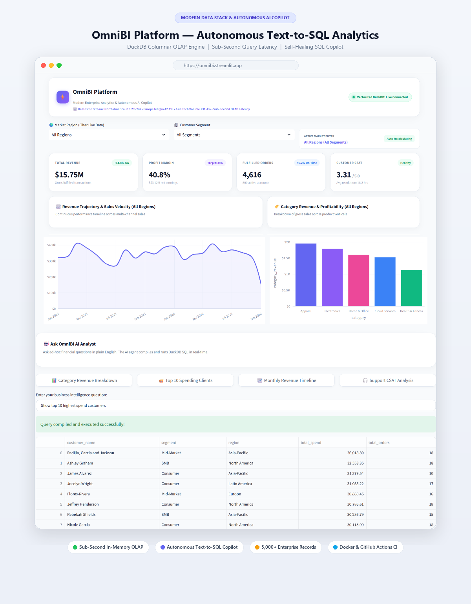
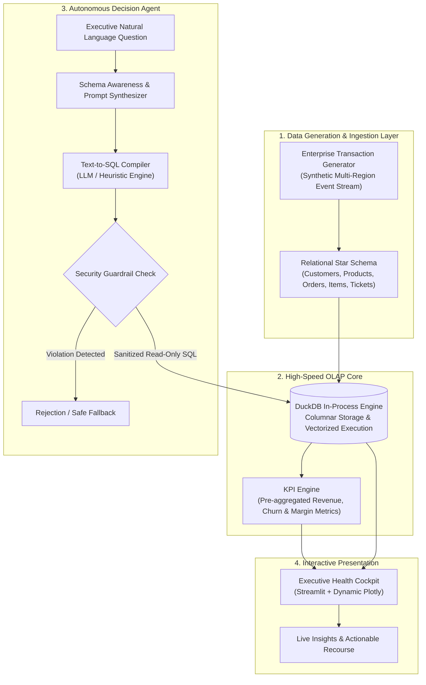

# ⚡ OmniBI: Autonomous Modern Data Platform & Real-Time Decision Agent

[](https://www.python.org/)
[](https://duckdb.org/)
[](https://streamlit.io/)
[](https://www.langchain.com/)
[](LICENSE)

An end-to-end, high-performance Business Intelligence & Analytics platform built on the **Modern Data Stack (MDS)**. OmniBI bridges the gap between massive analytical data warehouses and non-technical executive decision-makers by combining **sub-second in-process OLAP (DuckDB)** with an **Autonomous Natural Language-to-SQL AI Agent**.

<div align="center">
  
</div>

---

## 🏛️ System Architecture

<div align="center">
  
</div>

<details>
<summary><b>🔍 View Mermaid Specification</b></summary>


</details>

---

## ✨ Key Capabilities

- **Sub-Second Columnar Analytics:** Employs **DuckDB** to execute complex multi-table analytical joins across tens of thousands of records in milliseconds without requiring heavy external database clusters.
- **Autonomous Conversational Agent:** Translates plain English business questions into validated, optimized SQL queries with automatic self-correction and guardrails against destructive DDL/DML.
- **Executive Health Cockpit:** Real-time visibility into Gross Margins, Net Revenue velocity, Customer Churn Exposure, and CSAT Resolution Metrics.
- **Auto-Visualization Pipeline:** Dynamically inspects returned query schemas to render the most appropriate statistical charts (Sunburst, Area, Time-Series, Bar Charts).
- **Zero-Cloud-Cost & Self-Contained:** Runs entirely local or inside a single container with persistent storage and zero database licensing fees.

---

## 📂 Repository Structure

```
omnibi/
├── app/
│   └── dashboard.py               # Streamlit interactive executive interface
├── data/
│   ├── raw/                       # Raw extract snapshots
│   └── omnibi.duckdb              # In-process analytical DuckDB database
├── src/
│   ├── agent/
│   │   └── bi_agent.py            # Text-to-SQL autonomous AI agent
│   ├── analytics/
│   │   └── kpi_engine.py          # Executive KPI calculations & metrics
│   ├── database/
│   │   ├── connection.py          # DuckDB connection & schema manager
│   │   └── schema.sql             # Enterprise Star-Schema DDL
│   └── generator/
│       └── enterprise_data_gen.py # Synthetic multi-channel transaction generator
├── requirements.txt               # Project dependencies
├── .gitignore                     # Git ignore rules
└── README.md                      # Project documentation
```

---

## 🚀 Quick Start Guide

### 1. Clone & Set Up Environment
```bash
git clone https://github.com/your-username/omnibi.git
cd omnibi
python -m venv .venv
source .venv/bin/activate  # On Windows: .venv\Scripts\activate
pip install -r requirements.txt
```

### 2. Generate Data Warehouse & Seed DuckDB
```bash
python -m src.generator.enterprise_data_gen
```

### 3. Launch the Interactive Dashboard & AI Agent
```bash
streamlit run app/dashboard.py
```
Open your browser at `http://localhost:8501`.

---

## 🗄️ Database Star Schema

The warehouse is structured around an industry-standard star schema:

| Table | Type | Description |
| :--- | :--- | :--- |
| `dim_customers` | Dimension | Customer profiles, geographic regions, loyalty tiers, and churn risk scores. |
| `dim_products` | Dimension | Product catalog, unit costs, retail prices, and stock inventory. |
| `fact_orders` | Fact | Order headers, timestamps, payment methods, discounts, and order statuses. |
| `fact_order_items` | Fact | Line items per order, quantities, item revenues, and computed gross margins. |
| `fact_support_tickets`| Fact | Customer service issues, priority levels, resolution times, and CSAT scores. |

---

## 👤 Author & Academic Context

* **Developer:** Rejwana Akter
* **Department:** Computing & Information Systems (CIS), Major in Business Intelligence
* **Institution:** Daffodil International University (DIU)

